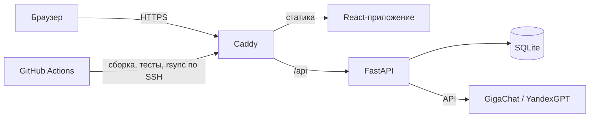

# Обнинский хакатон 2026

Проект команды. Пока это каркас: страница «Привет, мир» и API с проверкой здоровья.

- Сайт: https://31-77-173-151.sslip.io
- Документация API: https://31-77-173-151.sslip.io/api/docs

Пуш в `main` автоматически собирает, тестирует и выкатывает сайт.

## Начать работу

1. Установите Node.js 24+, [uv](https://docs.astral.sh/uv/), git и [Claude Code](https://claude.com/claude-code). На Mac: `brew install node uv git`.
2. Склонируйте репозиторий и подготовьте проект:
   ```bash
   npm run setup
   cp .env.example .env
   ```
3. Запустите: `npm run dev` и откройте http://localhost:5173

Дальше откройте Claude Code в папке проекта и описывайте задачи словами. Правила для ИИ лежат в [CLAUDE.md](CLAUDE.md).

## Архитектура



- **Фронтенд:** React + TypeScript + Vite, Tailwind CSS, shadcn/ui, Leaflet, Recharts. Собирается в GitHub Actions, сервер только раздаёт файлы.
- **Бэкенд:** Python, FastAPI, SQLModel, SQLite. Работает как сервис systemd.
- **ИИ:** российские модели по API, провайдер переключается в `.env`.

## Безопасность

- HTTPS с автоматическими сертификатами (Caddy + Let's Encrypt).
- Вход на сервер только по SSH-ключам, в файрволе открыты только SSH, HTTP и HTTPS.
- Бэкенд слушает только localhost и работает от отдельного пользователя без прав root.
- Ключи хранятся в `.env` на сервере и не попадают в git. Сервер находится в Москве, ИИ — российские модели.
