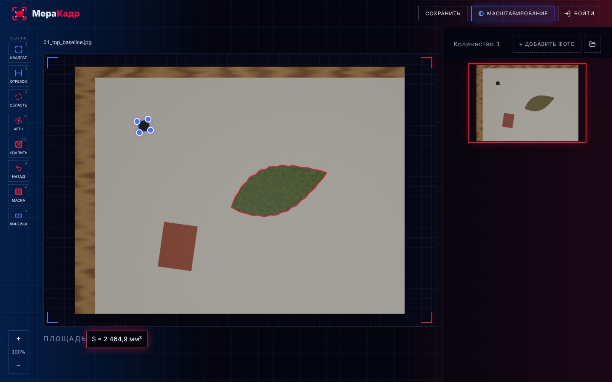
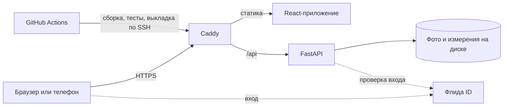

# МераКадр

Площадь объектов на фото по эталону известного размера и сравнение снимков в одном масштабе.
Кейс 03 «Один масштаб», Обнинский хакатон 2026.

- Сайт: **https://merakadr.ru**
- Документация API: https://merakadr.ru/api/docs



## Что умеет

- **Находит эталон сам.** Квадрат 1×1 см любого контрастного цвета: чёрный на светлом, белый на тёмном, цветной.
  Вместо квадрата можно взять линейку: протянуть отрезок по шкале и ввести его длину.
- **Исправляет наклон камеры** по краям листа бумаги, по сетке коврика для резки или миллиметровки, а если их нет —
  по искажению самого эталона.
- **Обводит образец**: точками по краю или кнопкой «Авто» — щелчок внутри, и контур находится сам. Shift+щелчок
  добавляет к обводке новые участки. На одном фото может быть несколько областей.
- **Считает площадь в мм²** с честной погрешностью ±%, периметр и расстояния (инструмент «Линейка»).
- **Масштабирование**: несколько фото рядом в одном масштабе — эталон на всех одного размера, сетка 1 см.
- **Сохраняет результат**: таблица CSV для Excel и фото в общем масштабе с контурами и подписью «имя, площадь, дата».
- **Работает с телефона**: отдельный мобильный интерфейс, фото с iPhone (HEIC), сжатие до 1 МБ перед загрузкой.
- **Вход через Флида ID.**

## Как пользоваться

1. **Снимите образец с эталоном.** Положите рядом квадрат 1×1 см (или линейку) и сфотографируйте сверху,
   чтобы оба были в кадре и на одной поверхности.
2. **Загрузите фото** на https://merakadr.ru. Эталон найдётся сам; если нет — нажмите «Квадрат» и подвиньте
   уголки рамки или щёлкните 4 угла.
3. **Обведите образец** кнопкой «Авто» или «Область» — площадь появится под фото. Несколько снимков можно
   привести к одному масштабу кнопкой «Масштабирование» и сохранить таблицей или фото.

Учебный прототип, не медицинское изделие.

## Точность

Проверена на 33 сценах, отрендеренных в Blender с известной правдой: наклон камеры до 60°, резкие тени, блики,
вспышка, размытие, ручка поверх эталона, коврик с сеткой, миллиметровка, телеобъектив. Эталон находится везде,
где он есть; средняя ошибка площади — 0,8%, медиана — 0,5%, хуже 3% — ни одного образца из 58.

От чего зависит точность и как устроены поиск эталона и исправление перспективы — в [backend/README.md](backend/README.md).

## Как устроено



- **Фронтенд** — React 19, TypeScript, Vite, Tailwind CSS, shadcn/ui. Рамка эталона, обводки, лупа и площадь
  во время перетаскивания считаются прямо в браузере, точный расчёт приходит с сервера.
- **Бэкенд** — Python 3.13, FastAPI, OpenCV, NumPy. Поиск эталона и контуров без нейросетей: классическое
  компьютерное зрение с уточнением краёв до долей пикселя. Фото и результаты хранятся на диске (JSON рядом с фото).
- **Сервер** — systemd и Caddy с автоматическим HTTPS. Пуш в `main` сам собирает, тестирует и выкатывает сайт
  за 1–2 минуты.

## Запуск у себя

Нужны Node.js 24+, [uv](https://docs.astral.sh/uv/) и git. На Mac: `brew install node uv git`.

```bash
git clone https://github.com/plaguedoc000/obninsk-hackathon.git
cd obninsk-hackathon
npm run setup          # библиотеки фронтенда и бэкенда
cp .env.example .env   # настройки; ключи не обязательны
npm run dev
```

Сайт откроется на http://localhost:3000, API — на http://localhost:8010 (документация http://localhost:8010/api/docs).
Вход через Флида ID локально работает только на порту 3000.

Проверка перед коммитом: `npm run check` — сборка фронтенда и все тесты бэкенда.

## Структура

```
frontend/            сайт (React)
  src/pages/         страницы
  src/components/    редактор, рамка эталона, сравнение, список фото
  src/lib/           запросы к API, геометрия, синхронизация с сервером
backend/             API (FastAPI)
  app/main.py        адреса API
  app/detection.py   поиск эталона
  app/geometry.py    масштаб, перспектива, площадь, погрешность
  app/contour.py     «Авто»: контур по щелчку
  app/routers/       вход через Флида ID
  tests/             автотесты, в том числе сцены из Blender с известной площадью
deploy/              настройка сервера
.github/workflows/   автодеплой
```

Все адреса API с примерами — в [backend/README.md](backend/README.md) и на `/api/docs`.

## Безопасность

- HTTPS с автоматическими сертификатами (Caddy + Let's Encrypt).
- Вход на сервер только по SSH-ключам, в файрволе открыты только SSH, HTTP и HTTPS.
- Бэкенд слушает только localhost и работает от отдельного пользователя без прав root.
- Ключи хранятся в `.env` на сервере и в секретах GitHub, в репозиторий не попадают.
- Вход через Флида ID: сайт не получает пароль и не хранит токены Флиды, только свою сессию в cookie.
